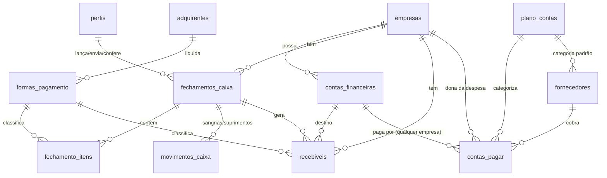

# RIRO · Sistema Financeiro: documento de passagem

> Estado em **13/10/2026**. Branch `claude/riro-financial-system-uwslqg` (ainda **não** mesclado na `main`).
> Este documento reúne o contexto do negócio, as decisões tomadas, a estrutura de dados, o design, as telas e as pendências, para quem for continuar o projeto.

**Sumário**
1. [Contexto do negócio](#1-contexto-do-negócio)
2. [O que já está pronto](#2-o-que-já-está-pronto)
3. [Decisões tomadas com a cliente](#3-decisões-tomadas-com-a-cliente)
4. [Arquitetura](#4-arquitetura)
5. [Estrutura de dados](#5-estrutura-de-dados)
6. [Regras de negócio](#6-regras-de-negócio)
7. [Permissões por perfil](#7-permissões-por-perfil)
8. [Design](#8-design)
9. [Telas](#9-telas)
10. [Como rodar, testar e publicar](#10-como-rodar-testar-e-publicar)
11. [Pendências e perguntas em aberto](#11-pendências-e-perguntas-em-aberto)
12. [Próximas fases](#12-próximas-fases)
13. [Limitações conhecidas](#13-limitações-conhecidas)
14. [Histórico de commits](#14-histórico-de-commits)

---

## 1. Contexto do negócio

**RIRO Salon** é um salão de cabeleireiro de alto padrão em São Paulo. O objetivo do sistema é ter **controles financeiros confiáveis**: conciliação, fluxo de caixa e DRE. Começamos pela parte financeira; o CRM vem depois.

### Empresas (CNPJs)
| Empresa | Papel | Observação |
|---|---|---|
| **JULIANA S.S.SILVA** | principal, maior volume | Santander 1547, Safra (Safrapay) e caixa físico |
| **R.RODRIGUES** | secundária | Recebe por **maquininha (Safrapay) e Pix**. Contas criadas com nome provisório: “Banco R. Rodrigues (a definir)” e “Safrapay R. Rodrigues” |

### Sistemas e fontes externas
- **Avec SalãoVIP** (`admin.avec.beauty`): sistema de agenda/comandas. Todo dia gera a tela **Fechamento de caixa**, que é a origem do lançamento diário. Linhas: Dinheiro (Comandas + Sangrias/Supr. + Valor inicial), Cartão Crédito por bandeira, Cartão Débito por bandeira, Cheque, Boleto, Transferência, Pix, Gift Card, **TOTAL FATURADO**; e, abaixo do total, Voucher, Permuta, Cortesia, Crédito utilizado, Dívidas.
- **Safrapay**: adquirente (maquininha). Taxas reais **ainda não confirmadas**.
- **Bancos**: Santander 1547 e Safra.

### Planilhas analisadas
1. **FLUXO RIRO SALON (out/2026)**, `.xlsm` com 12 abas. É a base financeira atual.
   | Aba | Conteúdo | Problema encontrado |
   |---|---|---|
   | VENDAS | vendas por tipo de pagamento, 18 mil linhas desde 12/2023, 26 tipos (muitos sem uso) | outubro não lançado |
   | FECH CX | modelo de fechamento diário | `#REF!`, datas de 2019 |
   | PAGTO | contas a pagar: DATA, FORNECEDOR, REFERENTE, EMPRESA, P/B, VENCIMENTO, NUMERO, VALOR, OK, MOTIVO/CONTA, BANCO | “OK” e banco manuais, sem conciliação |
   | CONTAS BANCÁRIAS | créditos/débitos por dia (Santander 1547, Safra, Dinheiro) | digitado à mão |
   | PROVISÃO | projeção diária | recebimentos zerados → saldo sempre negativo |
   | FECHAMENTO MÊS | DRE gerencial | receita zerada, `#DIV/0!` |
   | LEGENDA | plano de contas (10 grupos) | **reaproveitado** |
   | CH A PAGAR / CH CLIENTE | cheques | sem uso |
   | RECEITAS BT-LQ | receita bruta x líquida por dia | zerada em outubro |
2. **CRM RIRO_Corrigido FINAL.xlsx** (Google Drive): CRM de relacionamento (leads, orçamentos, pós-venda, recorrência, inativas, VIP, aniversariantes). **Fora do escopo** até agora; base para um futuro módulo de CRM.

> As planilhas **não** estão no repositório (contêm dados financeiros e nomes de pessoas). Peça os arquivos à cliente.

---

## 2. O que já está pronto

| Fase | Status | Conteúdo |
|---|---|---|
| **1. Fundação + Fechamento de caixa** | ✅ | Login, 4 perfis, layout responsivo, cadastros, fechamento diário espelhando o Avec, geração automática de contas a receber, conferência/reabertura, usuários |
| **2. Contas a pagar** | ✅ | Fornecedores, lançamentos (único, parcelado, recorrente), baixa individual e em lote, estorno, cancelamento, anexos, importação idempotente da aba PAGTO |
| 3. Conciliação | ⏳ próxima | Safrapay, OFX/CSV Santander e Safra, contagem do cofre |
| 4. Fluxo de caixa + DRE | ⏳ | |
| 5. Integração Avec + CRM | ⏳ | |

**Validações feitas** (ver [§10](#10-como-rodar-testar-e-publicar)):
- O fechamento real de 09/10 bate com o Avec (R$ 61.853,00) e gera 8 recebíveis: bruto R$ 63.383,00, taxas R$ 1.136,94, líquido R$ 62.246,06.
- A importação da PAGTO de outubro trouxe 353 lançamentos (R$ 1.485.394,09), 91 baixados como pagos e 72 fornecedores; reimportar não duplica.
- Regras testadas no banco com os perfis operação, financeiro e admin.
- Telas testadas em desktop (1360 px) e celular (390 px), sem rolagem horizontal.

---

## 3. Decisões tomadas com a cliente

| Tema | Decisão |
|---|---|
| Hospedagem | **Netlify** (preferência da cliente) + **Supabase** |
| Adquirente | **Safrapay**. Taxas provisórias da planilha: crédito 2%, débito 0,91%, D+1 útil. Marcadas como “taxa a confirmar” |
| Duas empresas | Sim. Maior volume na JULIANA S.S.SILVA. R. Rodrigues recebe por maquininha **e** Pix |
| Campo Dinheiro do fechamento | Operação digita só a linha **“– Comandas”** do Avec |
| Permuta | Entra na DRE como **receita** (não gera caixa) |
| Dívidas (fiado) | Viram **contas a receber da cliente** (prazo padrão 30 dias) |
| Voucher, Cortesia, Crédito utilizado, Gift Card | Não geram caixa nem recebível; configuráveis por flags |
| Despesa paga com conta de outra empresa | **Permitido e sinalizado** (“conta de outra empresa”), para acerto entre empresas. Na planilha, 6 despesas da R. Rodrigues foram pagas pelo Santander da Juliana |
| Competência (DRE) | Mês informado; na importação, `NUMERO` no formato `MM/AAAA` vira competência (ex.: FGTS 08/2026 pago em outubro) |

---

## 4. Arquitetura

### Stack
- **Next.js 15.5** (App Router, Server Components, Server Actions), **React 19.2**, **TypeScript** estrito
- **Supabase**: Postgres, Auth (e-mail/senha), Storage, **RLS**
- **Tailwind CSS 4** (tokens no `globals.css`), ícones **lucide-react**, fonte **Jost** (Google Fonts via `next/font`)
- **ExcelJS** (leitura em streaming da planilha); `overrides` no `package.json` corrigem `postcss` e `uuid` (0 vulnerabilidades no `npm audit`)
- Deploy: **Netlify** (`netlify.toml`, Node 22, plugin Next automático)

### Princípios
1. **As regras vivem no banco.** Triggers e funções `security definer` impedem estados inválidos mesmo que alguém contorne a interface.
2. **Transições só por funções.** Mudanças de status (enviar, conferir, reabrir, pagar, estornar, cancelar) usam a flag de sessão `riro.transicao = 'on'`, ligada apenas dentro dessas funções. Os triggers `proteger_*` bloqueiam qualquer outra alteração.
3. **Toda alteração é auditada** (tabela `auditoria`, trigger genérico) e ações sensíveis exigem **motivo**.
4. **Server Actions** chamam o Supabase com a sessão do usuário (RLS sempre ativa). A `service_role` é usada **somente** em `usuarios/actions.ts` para criar usuários.

### Estrutura de pastas
```
src/
  middleware.ts                 # renova sessão; manda para /login quem não está logado
  app/
    layout.tsx, globals.css     # fonte Jost e tokens de cor
    login/                      # página, formulário e action de login
    sair/route.ts               # logout (GET/POST)
    (app)/                      # área logada (layout com menu lateral)
      page.tsx                  # Painel
      fechamentos/              # lista do mês, novo, [id] (formulário) e actions
      recebiveis/               # contas a receber
      pagar/                    # lista, nova, [id], importar, actions, ListaContas, FormularioConta
      cadastros/                # abas: formas, empresas, contas, plano, fornecedores
      usuarios/                 # admin
  components/
    ui.tsx                      # Botao, Cartao, Entrada, Selecao, Selo, Aviso, Indicador...
    Estrutura.tsx               # menu lateral (desktop) e gaveta (celular)
  lib/
    supabase/{server,client,admin}.ts
    perfil.ts                   # obterPerfil, exigirPerfil(...papeis)
    tipos.ts                    # tipos, rótulos e cores de status
    formatacao.ts               # moeda, datas, lerValor (padrão BR), somar em centavos
    importacao/pagto.ts         # leitor da aba PAGTO
supabase/
  config.toml
  migrations/                   # 6 migrações, aplicar em ordem
scripts/testes/                 # testes SQL e Playwright, dados de demonstração
docs/PASSAGEM.md                # este documento
public/                         # logo-riro.png, logo-riro-branco.png, icone.png
```

---

## 5. Estrutura de dados

### Migrações (aplicar em ordem)
| Arquivo | Conteúdo |
|---|---|
| `20261012000001_estrutura.sql` | Tipos e tabelas da fase 1 |
| `20261012000002_regras.sql` | Funções, triggers, auditoria, RLS |
| `20261012000003_dados_iniciais.sql` | Empresas, contas, Safrapay, 19 formas de pagamento, plano de contas |
| `20261012000004_armazenamento.sql` | Bucket privado `comprovantes` |
| `20261013000005_contas_rodrigues.sql` | Contas banco/Safrapay da R. Rodrigues |
| `20261013000006_contas_pagar.sql` | Fornecedores, contas a pagar, funções, RLS, bucket `contas-pagar`, conta 9.01 “A classificar” |

### Diagrama


### Tipos (enums)
| Tipo | Valores |
|---|---|
| `papel_usuario` | operacao, gerente, financeiro, admin |
| `status_fechamento` | rascunho, enviado, conferido |
| `grupo_pagamento` | dinheiro, credito, debito, pix, transferencia, boleto, cheque, gift_card, voucher, permuta, cortesia, credito_utilizado, divida |
| `tipo_conta` | banco, caixa |
| `destino_recebivel` | caixa (cofre), banco (direto), adquirente (Safrapay), cliente (fiado) |
| `status_recebivel` | previsto, conciliado, divergente, cancelado |
| `tipo_movimento_caixa` | sangria, suprimento |
| `tipo_plano_conta` | receita, deducao, custo, despesa, investimento, participacao, financeiro |
| `forma_despesa` | boleto, pix, transferencia, recibo, debito_automatico, cartao, dinheiro |
| `status_conta_pagar` | aberto, pago, cancelado |

### Tabelas
**Cadastros**
- `empresas`: nome, razao_social, cnpj, principal, ativo, **conta_caixa_id / conta_banco_id / conta_adquirente_id** (para onde vai cada destino de recebível).
- `contas_financeiras`: empresa_id, nome, tipo (banco/caixa), banco, agencia, numero, ativo.
- `adquirentes`: Safrapay.
- `formas_pagamento`: espelha as linhas do Avec. Flags: `soma_total_avec`, `gera_recebivel`, `receita_dre`; `destino`, `prazo_dias`, `dias_uteis`, `taxa_percentual`, `taxa_confirmada`, `ordem`, `ativo`.
- `plano_contas`: codigo, nome, grupo (DRE), tipo, descricao, ordem.
- `fornecedores`: nome (único sem diferenciar maiúsculas), documento, plano_conta_id e forma_padrao (sugestões), chave_pix.
- `perfis`: 1:1 com `auth.users`; papel e ativo. Criado por trigger sempre como `operacao`.

**Fechamento e recebíveis**
- `fechamentos_caixa`: empresa_id + data (**únicos**), status, total_avec, dinheiro_inicial, dinheiro_contado, observacoes, comprovante_path, rastros (criado/atualizado/enviado/conferido por e em).
- `fechamento_itens`: forma_pagamento_id, quantidade, valor (≥ 0); único por fechamento+forma.
- `movimentos_caixa`: sangria/suprimento com valor > 0 e descrição.
- `recebiveis`: gerados no envio. data_venda, data_prevista, valor_bruto, taxa_percentual, **valor_taxa e valor_liquido calculados**, conta_id, destino, status, valor_recebido, data_recebimento (estes dois serão usados pela conciliação).

**Contas a pagar**
- `contas_pagar`: empresa_id (dona da despesa), fornecedor_id, plano_conta_id, descricao, documento, forma, data_lancamento, **competencia (1º dia do mês)**, data_vencimento, valor, parcela/total_parcelas, **grupo_id** (une parcelas e recorrências), codigo_barras, observacoes, status, data_pagamento, **conta_pagamento_id (pode ser de outra empresa)**, juros_multa, desconto, **valor_pago calculado**, pago_por/em, motivo_cancelamento, boleto_path, comprovante_path, origem (manual/planilha), **chave_importacao (única)**.

**Auditoria**
- `auditoria`: tabela, registro_id, acao (INSERT/UPDATE/DELETE/REABERTURA/ESTORNO/CANCELAMENTO), usuario_id, dados_antes, dados_depois (jsonb), motivo.

### Funções
| Função | Quem pode | O que faz |
|---|---|---|
| `papel_atual()`, `tem_papel(...)` | interna | papel do usuário logado (ativo) |
| `calcular_data_prevista(data, dias, uteis)` | interna | soma dias corridos ou úteis (seg a sex; **sem feriados**) |
| `enviar_fechamento(id)` | qualquer perfil ativo | valida total x Avec (ou exige justificativa), exige dinheiro contado, bloqueia data futura, **gera recebíveis**, status → enviado |
| `conferir_fechamento(id)` | financeiro, admin | enviado → conferido |
| `reabrir_fechamento(id, motivo)` | financeiro, admin | volta a rascunho, apaga recebíveis ainda “previsto”; bloqueia se algum já foi conciliado |
| `pagar_contas(ids[], data, conta, juros, desconto)` | financeiro, admin | baixa individual ou em lote (juros e desconto só na individual; data não pode ser futura) |
| `estornar_pagamento(id, motivo)` | financeiro, admin | pago → aberto |
| `cancelar_conta_pagar(id, motivo)` | financeiro, admin | aberto → cancelado |
| `importar_contas_pagar(jsonb)` | financeiro, admin | importa linhas já interpretadas; cria fornecedores; baixa as pagas no banco indicado; ignora chaves já existentes; devolve contagens e avisos |

### Storage (privado, URLs assinadas por 10 min)
- `comprovantes`: print do fechamento do Avec (`<fechamento_id>/<timestamp>.<ext>`).
- `contas-pagar`: boleto e comprovante (`<conta_id>/<boleto|comprovante>-<timestamp>.<ext>`). Limite de 5 MB, PDF ou imagem.

### Dados iniciais
- **Formas de pagamento** (19): Dinheiro; Crédito Amex/Elo/Hipercard/MasterCard/Visa; Débito Elo/Maestro/Visa; Cheque; Boleto; Transferência; Pix; Gift Card; Voucher; Permuta; Cortesia; Crédito utilizado; Dívidas (fiado).
- **Plano de contas**: 1.01 Serviços · 1.02 Venda de produtos · 1.03 Permutas · 1.04 Verbas de retorno · 2.01 Taxa de cartões · 2.02 Impostos · 3.01 Custo de mercadoria · 4.01 Pessoal · 4.02 Capacitação · 4.03 Ocupação · 4.04 Manutenção · 4.05 Funcionamento · 4.06 Marketing · 4.07 Materiais de consumo · 5.01 Imobilizado · 6.01 Pró-labore · 7.01 Processos e empréstimos · 9.01 A classificar.

---

## 6. Regras de negócio

### Fechamento de caixa
1. Um fechamento por **empresa + dia**. “Lançar” um dia que já existe abre o existente.
2. Formulário na mesma ordem do Avec. Duas seções: **Pagamentos** (somam no TOTAL FATURADO) e **Não somam no faturado**.
3. **Conferência com o Avec**: soma das formas com `soma_total_avec` = TOTAL FATURADO digitado. Se houver diferença, só envia com **observação**.
4. **Gaveta**: esperado = valor inicial + dinheiro das comandas + suprimentos − sangrias; comparado ao **dinheiro contado** (obrigatório para enviar).
5. Ao **enviar**: cada forma com `gera_recebivel` e valor > 0 vira um recebível. Data prevista = data do caixa + prazo (dias úteis se marcado). Conta = conta padrão da empresa para o destino. Taxa e líquido são calculados.
6. Só **rascunho** é editável. Reabrir exige motivo, que aparece no próprio fechamento.
7. Operação não vê valores no painel nem recebíveis.

### Contas a pagar
1. **Nova conta**: fornecedor com busca (cria se não existir), categoria, empresa, forma, documento, valor, vencimento, competência.
   - **Parcelada**: divide o valor em N parcelas mensais (centavos de sobra na 1ª), competência avança mês a mês.
   - **Recorrente**: repete o valor por N meses.
   - Todas recebem o mesmo `grupo_id`.
2. **Situação exibida**: Vencida (aberta com vencimento < hoje), Vence hoje, Em aberto, Paga, Cancelada.
3. **Baixa**: data (não futura) e conta de saída; individual aceita juros/multa e desconto. Em lote pela lista.
4. Conta **paga** fica travada (só aceita anexar comprovante). **Estorno** e **cancelamento** exigem motivo e aparecem no histórico. **Excluir** só em aberto (para erros de digitação).
5. Pagamento por **conta de outra empresa** é aceito e sinalizado.

### Importação da aba PAGTO (`src/lib/importacao/pagto.ts`)
| Coluna da planilha | Vira |
|---|---|
| A DATA | data_lancamento |
| B FORNECEDOR | fornecedor (criado se não existir) |
| C REFERENTE | descricao |
| D EMPRESA | empresa (pela razão social, ignorando espaços) |
| E P/B | forma (BOLETO, RECIBO, TRANSFERENCIA…) |
| F VENCIMENTO | data_vencimento |
| G NUMERO | `02/03` → parcela 2 de 3 · `08/2026` → competência ago/2026 · outro → documento |
| H VALOR | valor |
| I OK | “OK” → pago |
| J MOTIVO/CONTA | categoria → plano (tabela `CATEGORIAS`; desconhecida → 9.01) |
| K BANCO | SANTANDER/SAFRA → conta bancária com esse banco (prefere a da própria empresa); DINHEIRO → caixa físico |

- **Chave de importação** = SHA-1 de empresa, fornecedor, descrição, vencimento, valor e NUMERO, mais a ordem de ocorrência (duplicatas legítimas). Reimportar ignora o que já entrou.
- Pagas **sem banco** entram em aberto, com aviso. Data de pagamento das importadas = o menor entre o vencimento e hoje (a planilha não guarda o dia real).
- Fluxo em duas etapas: **Analisar** (prévia sem gravar) e **Importar**.

---

## 7. Permissões por perfil

| Recurso | Operação | Gerência | Financeiro | Admin |
|---|---|---|---|---|
| Painel | 7 dias, sem valores | + indicadores | + indicadores | + indicadores |
| Fechamento: lançar, salvar, enviar | ✅ | ✅ | ✅ | ✅ |
| Fechamento: conferir, reabrir | – | – | ✅ | ✅ |
| Contas a receber | – | ver | ver + editar | ver + editar |
| Contas a pagar | – | ver | tudo | tudo |
| Importar planilha | – | – | ✅ | ✅ |
| Cadastros (tela) | – | – | editar | editar |
| Usuários | – | – | – | ✅ |
| Histórico | motivos de reabertura | + estornos e cancelamentos | + estornos e cancelamentos | auditoria completa |

Excluir fechamento em rascunho: quem criou ou gerência para cima.

---

## 8. Design

### Identidade
- **Logo**: “RIRO” em cobre texturizado (`public/logo-riro.png`), versão branca para fundo escuro (`logo-riro-branco.png`) e ícone “R” (`icone.png`, favicon).
- **Clima**: alto padrão, sóbrio, muito respiro, tipografia fina.

### Cores (tokens em `src/app/globals.css`)
| Token | Hex | Uso |
|---|---|---|
| `cobre-500` | `#B97953` | cor do logo (amostrada) |
| `cobre-600` | `#9E6141` | botão primário, abas ativas |
| `cobre-700` | `#804D34` | títulos de cartão (caixa alta), links |
| `cobre-50…900` | escala completa | fundos de destaque, bordas |
| `creme` | `#FAF7F4` | fundo da página |
| `grafite` | `#2B2522` | texto e menu lateral |
| `linha` | `#E9E1DA` | bordas e divisórias |

Cores semânticas: verde (confere/pago/conferido), âmbar (atenção/rascunho/vence hoje), vermelho (diferença/vencida/atrasado), azul (enviado/previsto/em aberto).

### Tipografia
- **Jost** (geométrica, combina com o logo) em todo o sistema; títulos em peso 300.
- Números com `tabular-nums` (classe `.num`).
- Rótulos e títulos de cartão em caixa alta com espaçamento largo.

### Componentes (`src/components/ui.tsx`)
`Cabecalho`, `Cartao`, `TituloCartao`, `Botao` / `BotaoLink` (primario, secundario, perigo, fantasma), `Entrada`, `Selecao`, `AreaTexto`, `Rotulo`, `Campo`, `Selo` (pílula de status), `Aviso` (faixas coloridas), `Indicador` (KPI), `Vazio`, `cx`.

### Padrões de layout
- **Desktop**: menu lateral grafite fixo de 256 px com logo branco; conteúdo com largura máxima de 6xl.
- **Celular**: barra superior com logo e menu em gaveta pela direita; tabelas viram cartões; barras de ação fixas no rodapé.
- **Formulários longos** (fechamento, pagamento em lote) têm barra fixa inferior com o total e as ações.
- Valores digitados no padrão brasileiro (`lerValor`): `1.234,56`, `21.380` (milhar), `1234,5`.

---

## 9. Telas

Galeria com capturas reais (desktop e celular): **https://claude.ai/artifact/BYaWH4YV23ng4udUCogmSC** (privada da conta da cliente; compartilhe pelo menu Share).
As mesmas capturas estão na pasta `telas/` do pacote de passagem (.zip).

| Rota | Tela | Perfis |
|---|---|---|
| `/login` | Login com logo | todos |
| `/` | Painel: indicadores (faturado no mês, aguardando conferência, a receber 7 dias, recebíveis atrasados, a pagar 7 dias + vencidos, saldo previsto 7 dias) e últimos 7 dias de cada empresa | todos (valores só gerência+) |
| `/fechamentos` | Dias do mês com status e total; alterna empresa; atalho “lançar” | todos |
| `/fechamentos/novo` | Escolhe empresa e data | todos |
| `/fechamentos/[id]` | Formulário do fechamento, gaveta, sangrias, observações, print; enviar/conferir/reabrir | todos |
| `/recebiveis` | Contas a receber com filtros e totais bruto/taxa/líquido | gerência+ |
| `/pagar` | Lista por vencimento, indicadores, filtros, pagamento em lote | gerência+ |
| `/pagar/nova` | Nova conta (única/parcelada/recorrente) com prévia | financeiro+ |
| `/pagar/[id]` | Detalhe, pagamento, anexos, parcelas, edição, estorno/cancelamento, histórico | gerência+ (ações financeiro+) |
| `/pagar/importar` | Importação da aba PAGTO (analisar → importar) | financeiro+ |
| `/cadastros` | Abas: formas de pagamento (taxas Safrapay), empresas, contas, plano de contas, fornecedores | financeiro+ |
| `/usuarios` | Criar acesso, trocar perfil, redefinir senha, desativar | admin |

Itens “em breve” já aparecem no menu: Conciliação, Fluxo de caixa, DRE.

---

## 10. Como rodar, testar e publicar

### Local
```bash
cp .env.example .env.local      # preencher
npm install
npx supabase start              # Docker; aplica as migrações
npm run dev
```
Variáveis: `NEXT_PUBLIC_SUPABASE_URL`, `NEXT_PUBLIC_SUPABASE_ANON_KEY`, `SUPABASE_SERVICE_ROLE_KEY` (só servidor).

Checagens rápidas: `npm run typecheck` e `npm run build`.

### Testes
Ver `scripts/testes/README.md`: usuários de teste, testes SQL de regras, testes Playwright do fechamento e do contas a pagar, captura de telas e dados de demonstração.

### Produção
1. **Supabase**: criar projeto (região São Paulo) → rodar as 6 migrações em ordem → desativar “Allow new users to sign up” → criar o primeiro usuário e promover:
   ```sql
   update perfis set papel = 'admin', nome = 'Nome' where email = 'email@dominio';
   ```
2. **Netlify**: importar o repositório, configurar as 3 variáveis, publicar.
3. Entrar como admin → **Cadastros**: confirmar taxas Safrapay, dados bancários da R. Rodrigues e CNPJs → **Usuários**: criar os acessos da equipe → **Contas a pagar → Importar planilha**.

> O branch ainda não foi mesclado na `main`. Abra o PR (ou mescle) antes de apontar o Netlify para a `main`.

---

## 11. Pendências e perguntas em aberto

| # | Item | Com quem |
|---|---|---|
| 1 | **Taxas e prazos reais da Safrapay** (crédito à vista, parcelado, débito; antecipação?) | cliente |
| 2 | **Banco, agência e conta da R. Rodrigues** (contas criadas com nome provisório) | cliente |
| 3 | **CNPJs** das duas empresas (campo vazio) | cliente |
| 4 | **Crédito parcelado**: o Avec mostra só o total por bandeira; hoje cada bandeira vira um recebível único. Resolver com o extrato da Safrapay | conciliação |
| 5 | **Despesas de Pessoal** = R$ 553 mil (37% do importado). Separar folha, comissões, encargos e benefícios antes da DRE? | cliente |
| 6 | **Data real de pagamento** das contas importadas (usado o vencimento) | conciliação |
| 7 | **Dias de funcionamento**: domingo aparece em cinza; o salão fecha às segundas? | cliente |
| 8 | **Feriados** no cálculo de D+N úteis | desenvolvimento |
| 9 | 3 linhas da PAGTO com “OK” e sem banco entraram em aberto | financeiro dar baixa |

---

## 12. Próximas fases

### Fase 3: Conciliação (proposta)
- **Tabelas novas**: `extratos_bancarios` (conta, data, descrição, valor, documento, hash único), `extratos_adquirente` (venda, data prevista/paga, bandeira, parcela, bruto, taxa, líquido, NSU), `conciliacoes` (ligação N:N entre lançamentos de extrato e recebíveis/contas a pagar, com diferença e justificativa), `contagens_cofre`.
- **Importadores**: OFX e CSV (Santander, Safra) e relatório de vendas/recebimentos da Safrapay. Mesmo padrão idempotente da PAGTO (hash do lançamento).
- **Casamento automático** por valor + data (com tolerância) + conta; sugestões para revisão; baixa de recebível (`status = conciliado`, `valor_recebido`, `data_recebimento`) e confirmação da data real dos pagamentos.
- **Recebíveis atrasados** do painel passam a refletir só o que realmente não entrou.
- **Acerto entre empresas**: relatório das despesas pagas com conta de outra empresa.

### Fase 4: Fluxo de caixa e DRE
- **Fluxo**: realizado (só conciliado) + projetado (recebíveis previstos − contas em aberto), por dia/semana/mês e por conta, com saldo inicial bancário.
- **DRE**: por competência, com a estrutura da aba FECHAMENTO MÊS (receita bruta, deduções, lucro bruto, despesas operacionais por grupo, imobilizado, pró-labore, resultado). Receita = itens com `receita_dre` dos fechamentos; despesas = contas a pagar por `competencia` e `plano_contas.grupo`.

### Fase 5
- Integração com o Avec (API ou importação do fechamento), evitando digitação.
- Módulo de CRM a partir da planilha “CRM RIRO_Corrigido FINAL”.

---

## 13. Limitações conhecidas
- Feriados não são considerados no cálculo de dias úteis.
- Testes automatizados são scripts (SQL e Playwright) em `scripts/testes`; ainda não há suíte integrada ao CI.
- `next.config.ts`: Server Actions aceitam até 8 MB; a importação limita a planilha a 6 MB (limite de payload das funções da Netlify).
- Escolhemos Next 15.5 (estável); migrar para Next 16 exige trocar `middleware.ts` pelo novo padrão.
- A lista de contas a pagar carrega até 2.000 itens por filtro (paginação futura).
- `supabase/config.toml` usa as portas padrão; nos testes locais desta sessão foram usadas 643xx.

---

## 14. Histórico de commits
| Commit | Descrição |
|---|---|
| `7e459ff` | Fundação: login, perfis, fechamento de caixa, contas a receber, cadastros, usuários |
| `6884239` | Leitura de valores com ponto de milhar (“21.380”), contas da R. Rodrigues, rodapé do fechamento |
| `c9432c2` | Contas a pagar completo + importação da PAGTO |
| (este) | Documento de passagem, CLAUDE.md e scripts de teste |
